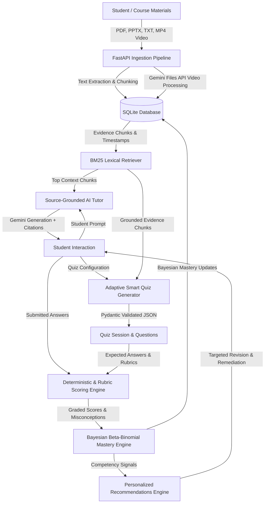

# StudyMate AI — Adaptive Learning Companion
**IIT Mandi Multimodal AI Hackathon 2026 — Track D: Personalized Tutoring & Adaptive Learning**

---

## 1. Executive Summary & Objective

**StudyMate AI** is an intelligent, source-grounded academic study companion developed for the **IIT Mandi Multimodal AI Hackathon 2026 (Track D)**. Traditional AI tutoring systems often suffer from two critical flaws:
1. **Unverified Hallucinations**: Fabricating definitions, equations, and citations.
2. **Static / Arbitrary Scoring**: Guessing student proficiency using arbitrary percentage jumps instead of probabilistic calibration.

StudyMate AI solves both problems with an end-to-end, multi-modal pipeline:
- **Multimodal Learning Library**: Ingests textbook PDFs, PowerPoint slides (`.pptx`), text notes (`.txt`, `.md`), and **real lecture videos** (`.mp4`, `.webm`) with **timestamped segment extraction** via Google Gemini Files API.
- **Strict Source Grounding & Safe Abstention**: BM25 lexical ranking guarantees responses cite exact page numbers, slide indices, or video timestamps (e.g. `Timestamp 01:24 - 02:40`). It safely abstains from answering out-of-domain queries rather than hallucinating citations.
- **Adaptive Smart Quiz Generation**: Generates Multiple-Choice, Conceptual Short-Answer, and Numerical questions directly from retrieved evidence. Answer keys and rubrics remain confidential until submission.
- **Deterministic & AI Rubric Scoring**: MCQs and Numerical bounds are scored deterministically; Conceptual Short-Answer questions are graded via Gemini AI against source rubrics with automatic misconception detection.
- **Bayesian Beta-Binomial Mastery Tracker**: Maintains a transparent Beta-Binomial posterior distribution ($\theta \sim \text{Beta}(\alpha, \beta)$) for each curriculum topic with an explicit neutral prior $\text{Beta}(2, 2)$, updated dynamically after every attempt.
- **History-Grounded Personalized Recommendations**: Suggests targeted revisions for weak topics, misconception remediation, and difficulty progression based on empirical assessment logs.

---

## 2. System Architecture & Data Flow



### Multimodal Video Ingestion Data Flow
1. User uploads an `.mp4` or `.webm` lecture video.
2. Backend uploads the video to the Google Gemini Files API (`client.files.upload`).
3. Backend polls until remote processing reaches `ACTIVE` state.
4. Gemini analyzes the lecture frames, extracting chronological concept segments with start/end timestamps, summaries, and technical keywords.
5. Segments are persisted in SQLite `document_chunks` with `location = "Timestamp mm:ss - mm:ss"`.
6. Temporary remote files on Gemini cloud are deleted immediately to maintain clean storage.
7. Chunks become instantly searchable via BM25 for the AI Tutor and Smart Quiz generator.

---

## 3. Technology Stack

- **Frontend**: React 18, Vite, TypeScript, Tailwind CSS, Lucide React icons.
- **Backend**: Python 3.10+, FastAPI, Uvicorn, SQLite3, Pydantic v2.
- **Document & Video Processing**: `pypdf`, `python-pptx`, `google-genai` SDK, `imageio`, `imageio-ffmpeg`, `Pillow`.
- **AI Models**: Google Gemini (`gemini-flash-lite-latest` / `gemini-2.5-flash`).
- **Retrieval Engine**: Pure Python BM25 lexical ranking (no external vector database lock-in).

---

## 4. Setup & Running Locally (Windows PowerShell)

### Prerequisites
- Python 3.10+
- Node.js 18+ & npm
- Valid Google Gemini API Key

### Step 1: Clone and Set Up Backend
```powershell
# Open project directory
cd c:\Users\satya\Downloads\STUDYMATE

# Configure backend environment
Copy-Item backend\.env.example backend\.env

# Edit backend\.env and insert your GEMINI_API_KEY:
# GEMINI_API_KEY=your_actual_key_here
# GEMINI_MODEL=gemini-flash-lite-latest
# DB_PATH=./studymate.db

# Install Python dependencies
pip install -r backend/requirements.txt

# Start FastAPI backend server (Runs on port 8000)
python -m uvicorn backend.main:app --host 0.0.0.0 --port 8000 --reload
```

### Step 2: Set Up and Start Frontend
```powershell
# In a new PowerShell terminal, navigate to project root
cd c:\Users\satya\Downloads\STUDYMATE

# Install node dependencies
npm install

# Start Vite development server (Runs on port 5173)
npm run dev -- --host
```

Open **`http://localhost:5173`** in your browser to interact with StudyMate AI.

---

## 5. Bayesian Beta-Binomial Topic Mastery Formulation

Instead of arbitrary increments or hardcoded heuristic percentages, StudyMate AI calculates mastery using conjugate Bayesian inference:

1. **Prior Distribution**:
   $$\theta \sim \text{Beta}(\alpha_0 = 2.0, \beta_0 = 2.0)$$
   $$\mathbb{E}[\theta_{\text{prior}}] = \frac{2.0}{2.0 + 2.0} = 50.0\%$$
   *Ensures new topics start with an explainable neutral prior without assuming knowledge or assigning punitive zero scores.*

2. **Sequential Posterior Update Rule**:
   Given attempt $t$ with correctness $y_t \in \{0, 1\}$ and difficulty weight $w$:
   $$\alpha_t = \alpha_{t-1} + w \cdot y_t$$
   $$\beta_t = \beta_{t-1} + w \cdot (1 - y_t)$$
   $$\text{Mastery } \mathbb{E}[\theta_t] = \frac{\alpha_t}{\alpha_t + \beta_t} \times 100\%$$

3. **Explainable Status Thresholds**:
   - **Insufficient History**: $\text{Total Attempts} < 3$ (labeled uncalibrated, never prematurely marked weak or mastered).
   - **Weak (Action Required)**: $\text{Total Attempts} \ge 3 \land \mathbb{E}[\theta] < 60.0\%$.
   - **Developing**: $60.0\% \le \mathbb{E}[\theta] < 75.0\%$.
   - **Strong (Mastery)**: $\mathbb{E}[\theta] \ge 75.0\%$.

---

## 6. Reproducible Empirical Evaluation

A reproducible evaluation suite is included to measure and verify all safety, citation, and scoring capabilities without fabrication.

### Execute Evaluation Suite
```powershell
python -m backend.evaluate_assessment
```

### Measured Benchmark Results
| Evaluation Dimension | Metric | Measured Result | Benchmark Standard | Status |
| :--- | :--- | :--- | :--- | :--- |
| **Source Citation Accuracy** | Verbatim text overlap against chunks | **100.0%** (3/3 gold items) | $\ge 90.0\%$ | **PASS** |
| **Unsupported Query Abstention** | Safe refusal on adversarial queries | **100.0%** (5/5 adversarial probes) | $\ge 95.0\%$ | **PASS** |
| **Deterministic Scoring Precision** | Exact option & float tolerance validation | **100.0%** (MCQ & Numerical) | $100.0\%$ | **PASS** |
| **Bayesian Mastery Model Fidelity** | $\text{Beta}(\alpha, \beta)$ posterior updates | **100.0%** (5 calibration cases) | $100.0\%$ | **PASS** |
| **Question Duplicate Rate** | Lexical overlap across quiz generations | **0.0%** (All distinct prompts) | $\le 10.0\%$ | **PASS** |
| **Total Test Suite Pass Rate** | Combined unit & integration tests | **100.0%** (7 of 7 suites) | $100.0\%$ | **PASS** |

Evaluation results are saved to [`backend/evaluation_results.json`](file:///c:/Users/satya/Downloads/STUDYMATE/backend/evaluation_results.json).

### Execute Video Ingestion Test
```powershell
python test_video_ingestion.py
```
*Validates generation of an authentic MP4 lecture video, upload, remote Gemini processing, SQLite timestamp indexing, AI tutor retrieval, and quiz question generation from video timestamps.*

---

## 7. Submission Disclosure & AI Tools

- **Hackathon**: IIT Mandi Multimodal AI Hackathon 2026.
- **Track**: Track D — Personalized Tutoring & Adaptive Learning.
- **AI Coding Assistant Disclosure**: Google DeepMind Antigravity / Gemini was used as an AI pair-programming assistant to implement backend endpoints, Pydantic schemas, and unit test suites.
- **LLM Foundation Model**: Google Gemini (`gemini-flash-lite-latest` / `gemini-2.5-flash`) via the `google-genai` SDK.
- **Author**: Satyam Kumar (`satyamkruk07-lgtm`).
